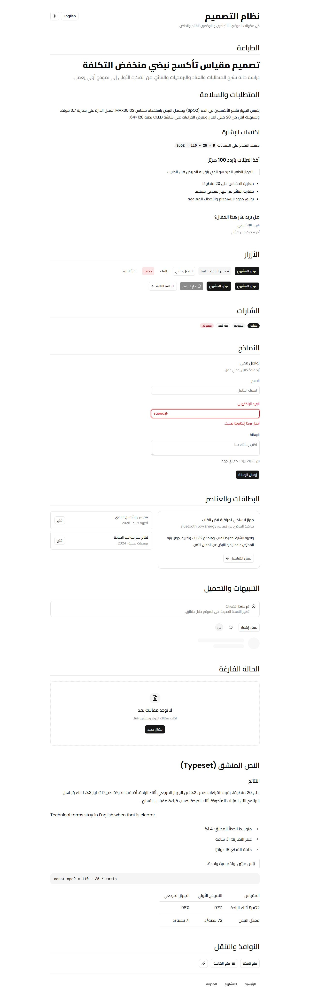
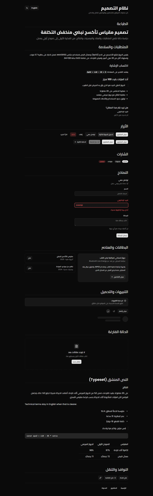
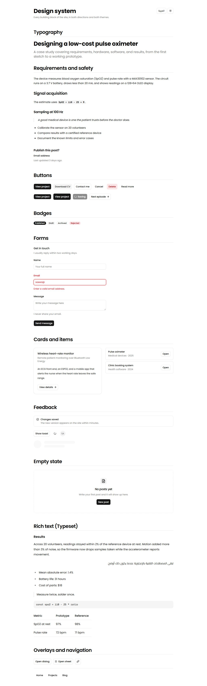
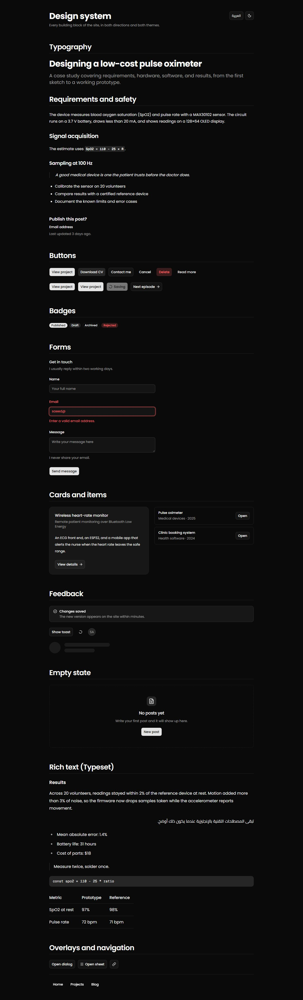

# Phase 1 review: Design system

## Summary

The preset's look is unchanged, with Poppins for Latin text, Cairo for Arabic, and Geist Mono for code. Both directions and both themes work. The phase adds the shadcn typography components (logical classes, Arabic-aware), Typeset with a `typeset-article` preset, a Light/Dark/System toggle, the 19 base components, and a dev-only `/design` page that shows all of them. Four guards now run in the gate: theme freeze, logical classes only, rendered fonts, and axe.

## Gate results

| Step      | Result                                                                                                                              |
| --------- | ----------------------------------------------------------------------------------------------------------------------------------- |
| format    | pass                                                                                                                                |
| lint      | pass, 0 warnings                                                                                                                    |
| typecheck | pass                                                                                                                                |
| test      | 22 passed (unit 20, component 2); coverage thresholds start in Phase 5                                                              |
| test:e2e  | 40 passed across ar-light, ar-dark, en-light, en-dark, ar-mobile (8 tests each)                                                     |
| build     | pass; `/` loads 8 scripts, 211.4 KB gzip (Phase 0: 170.5 KB; the root layout now ships the direction, tooltip, and toast providers) |

## Done when

- [x] Latin text renders in Poppins and Arabic text in Cairo, in both themes. The e2e test asks Chromium which fonts drew each node: an Arabic heading uses Cairo (spaces from Poppins), English uses Poppins only, and a single Arabic word uses Cairo only.
- [x] Editing one color token makes the gate fail; reverting it makes it pass. Changing `--primary` in `:root` failed `tests/guards/theme-tokens.test.ts` with a one-line diff, and the revert passed.
- [x] The mode toggle switches light, dark, and system with no flash on reload. The test confirms the theme class is already on `<html>` when parsing ends, before React hydrates.
- [x] Axe reports no serious or critical issues on `/design`, in all five projects.
- [x] This review includes the four screenshots, plus mobile.

## Changes

**Fonts and theme**

- `app/layout.tsx`: Poppins, Cairo, and Geist Mono; `DirectionProvider`, `TooltipProvider`, and the sonner `Toaster`.
- `app/globals.css`: only the `--font-sans` line changed, plus the `typeset.css` import. The theme snapshot confirms no token changed.

**Components**

- `components/ui/typography.tsx` (new): `H1`–`H4`, `P`, `Lead`, `Large`, `Small`, `Muted`, `Blockquote`, `List`, `InlineCode`, built with `cva`, `cn`, `data-slot`, and `asChild`.
- `components/layout/mode-toggle.tsx` (new).
- `components/ui/`: direction, card, badge, separator, skeleton, sonner, tooltip, dropdown-menu, sheet, dialog, alert, empty, spinner, field, input, textarea, label, item, avatar, navigation-menu (via `shadcn add`).
- `components/ui/button.tsx`, `badge.tsx`, `avatar.tsx`: light-mode contrast fixes. `sheet.tsx`: one `rtl-ok` marker.

**Typeset**

- `app/typeset.css` (new): the builder's stylesheet plus the `typeset-article` preset.

**Design page**

- `app/design/` (new): `page.tsx`, `content.ts` (Arabic and English sample text), `enabled.ts` (the production gate), `toast-button.tsx`, `page.test.ts`.
- `lib/env.ts`, `.env.example`: optional `DESIGN_PAGE` (`on` or `off`).

**Tests**

- `tests/guards/theme-tokens.test.ts` and its snapshot (new): 101 color and radius tokens.
- `tests/guards/logical-classes.test.ts` (new): scans `app/`, `components/`, and `features/` and prints file, line, and class.
- `tests/e2e/design.spec.ts` (new): direction, no horizontal scroll, axe, rendered fonts, the Typeset preset, theme without flash, and screenshots.
- `tests/fixtures/env.ts` (new); `lib/env.test.ts` uses it. `playwright.config.ts` serves `/design` with `DESIGN_PAGE=on`.

## Decisions and deviations

All are in `docs/decisions.md`. The ones that need your attention:

1. **Arabic was being drawn in Arial, not Cairo.** next/font puts a "Poppins Fallback" face (local Arial, covering every character) between Poppins and Cairo. Arial has Arabic glyphs, so Cairo never loaded. The usual switch (`adjustFontFallback: false`) works with webpack, but Turbopack, the default build in Next.js 16, ignores it; I confirmed this with clean builds of both. The fix is the one allowed variable: `--font-sans` now names `"Poppins"` directly. The computed `font-family` looked correct throughout; only the rendered-fonts test caught this.
2. **Contrast fixes in Button, Badge, and Avatar (light mode only).** axe found the preset's destructive Button and Badge text at 4.0:1 and the avatar initials at 4.34:1, where 4.5:1 is the minimum. Their text now mixes in a little of the foreground token, the same `color-mix` idiom the preset's secondary button uses. Tokens and dark mode are unchanged. Every "Delete" button in the dashboard would otherwise fail the accessibility check.
3. **`typeset.css` came from the builder's source.** Its "Get Code" button serves one file from the shadcn repo unmodified. I copied that file (commit 4233ed1, default fonts) instead of waiting for your download. Drop in your own builder output if you prefer it; the preset sits in a separate block at the end.
4. **`/design` picks its language with `?lang=ar|en`** until Phase 2 adds `/ar` and `/en`. Its overlays (dialog, sheet, tooltip) render under `<body>`, which stays `dir="ltr"` until Phase 2.
5. **Typography deviates slightly from the docs.** `H1` drops the docs' demo `text-center`. In Arabic, headings drop letter-spacing (it breaks letter joins) and blockquotes drop italics (Cairo has none).

## How to check it yourself

1. Run `npm run dev`, then open:
   - http://localhost:3000/design (Arabic, right to left)
   - http://localhost:3000/design?lang=en (English)
2. Use the sun icon to switch Light, Dark, and System, then reload. The theme holds with no flash, and `d` still toggles it.
3. In Chrome DevTools, select the Arabic page title and open Computed → Rendered Fonts. It lists Cairo, plus Poppins for the spaces.
4. To see the theme freeze, change any color in `app/globals.css` and run `npx vitest run tests/guards`. The test fails with a diff; revert the color.
5. No accounts are needed yet.

## Screenshots

| Arabic, light                      | Arabic, dark                     |
| ---------------------------------- | -------------------------------- |
|  |  |

| English, light                     | English, dark                    |
| ---------------------------------- | -------------------------------- |
|  |  |

Mobile, Arabic: [phase-1/ar-mobile.jpeg](phase-1/ar-mobile.jpeg)

## Risks and open questions

1. **The font fix depends on next/font naming the family `Poppins`.** It does in both bundlers today, and the rendered-fonts test fails if that changes. Once Turbopack honors `adjustFontFallback`, `--font-sans` can go back to `var(--font-poppins)`.
2. **Performance budget (Phase 7).** Every page now preloads 7 font files, including all 5 Poppins weights, and `/` ships 211 KB of JavaScript (gzip). Dropping unused weights (for example 300) is the obvious first cut.
3. **Some screen-reader text is still English:** "Close" in Dialog and Sheet, "Loading" in Spinner, and the toggle's labels. Phase 2 moves them into the message files.
4. **Docker is still not installed.** It is needed from Phase 3, unless you choose the plan's fallback: a second Supabase project as the dev database.

## Proposed commit message

```text
feat(design): fonts, RTL, theme toggle, typography, Typeset, and /design page

- Poppins for Latin, Cairo for Arabic; work around Turbopack ignoring
  adjustFontFallback, which drew Arabic in Arial
- Add DirectionProvider, mode toggle, typography components, Typeset with
  a typeset-article preset, and 19 base shadcn components
- Fix light-mode contrast of destructive Button/Badge and Avatar fallback
- Add the dev-only /design page in Arabic and English
- Guard theme tokens, logical classes, rendered fonts, and accessibility

Co-Authored-By: Claude Opus 5.5 (1M context) <noreply@anthropic.com>
```
