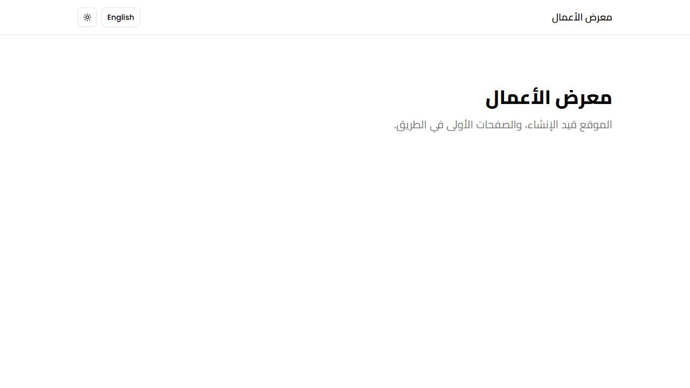
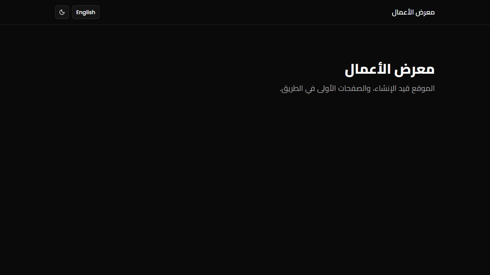
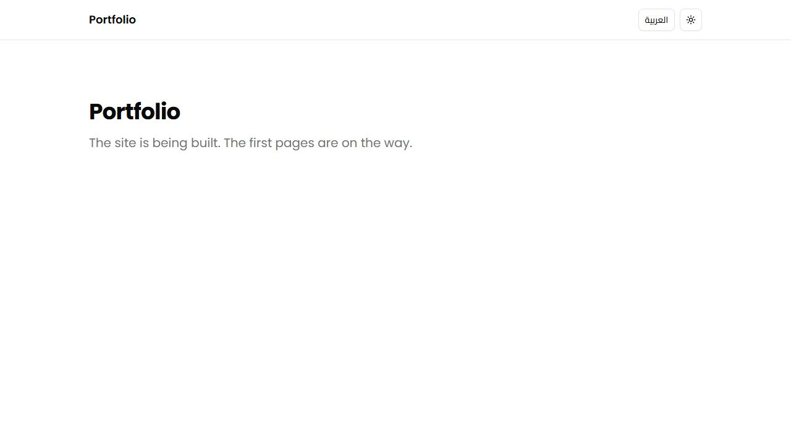
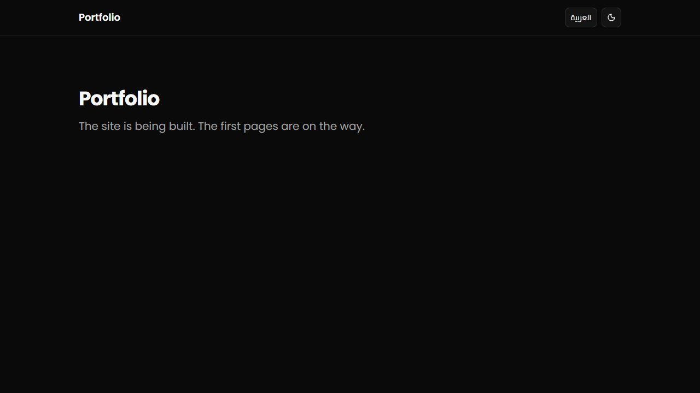

# Phase 2 review: Internationalization

## Summary

Every route now lives under `/ar` or `/en`. `/` redirects to `/ar`, `<html>` carries the locale's `lang` and `dir`, and dates and numbers use shared formats (Asia/Damascus, Western digits). All visible text comes from `messages/ar.json` and `messages/en.json`, and three things enforce that: types, a parity test, and an ESLint rule. A minimal site shell (name, language switcher, theme toggle) wraps a placeholder home page. Zod schemas now carry message keys, which a field-error component translates.

## Gate results

| Step      | Result                                                                                             |
| --------- | -------------------------------------------------------------------------------------------------- |
| format    | pass                                                                                               |
| lint      | pass, 0 warnings (now includes the import ban and `react/jsx-no-literals`)                         |
| typecheck | pass; message keys are typed against `en.json`                                                     |
| test      | 30 passed (unit 23, component 7)                                                                   |
| test:e2e  | 80 passed across ar-light, ar-dark, en-light, en-dark, ar-mobile (16 tests each)                   |
| build     | pass; `/ar` loads 13 scripts, 248 KB gzip (Phase 1: 211 KB; the next-intl client and the switcher) |

## Done when

- [x] Every page of the shell renders in both locales with the correct direction: home, `/design`, the localized 404, and the global 404. Tests check `lang` and `dir` on `<html>` in all five projects.
- [x] No hardcoded visible strings remain, and the key-parity test passes. ESLint now rejects JSX text, and the parity test also compares ICU arguments.
- [x] Dates and numbers format the same on server and client, with no hydration warnings. The design page formats each value on the server and again in a browser set to Los Angeles time. The test compares both columns, expects "7 أكتوبر 2026" and "October 7, 2026", and fails on any console error or Arabic-Indic digit.
- [x] `docs/reviews/phase-2.md` is written.

Plan tests: `/` redirects to `/ar`; `/ar` is `lang="ar" dir="rtl"`; `/en` is `lang="en" dir="ltr"`; the switcher keeps the path both ways; `/fr/anything` returns 404.

## Changes

**i18n core**

- `i18n/routing.ts`, `i18n/navigation.ts`, `i18n/request.ts` (root params, explicit-locale override, `hasLocale` + `notFound`), `i18n/formats.ts`, `i18n/keys.ts` (`MessageKey`, `ValidationKey`).
- `global.d.ts` (next-intl `AppConfig`), `proxy.ts` (next-intl middleware), `next.config.ts` (next-intl plugin, `globalNotFound`).
- `messages/en.json`, `messages/ar.json`, `messages/messages.test.ts`.

**Routes**

- Removed `app/layout.tsx` and `app/page.tsx`.
- Added `app/[locale]/layout.tsx` (the only root layout), `app/[locale]/(site)/layout.tsx` and `page.tsx`, `app/[locale]/not-found.tsx`, `app/[locale]/[...rest]/page.tsx`, `app/global-not-found.tsx`, and `app/fonts.ts`.
- Moved `app/design/` to `app/[locale]/design/`. Its text moved into the `design` namespace; `content.ts` is gone. Added a dates-and-numbers section (`client-formatted.tsx`, `formatting-sample.ts`).

**Components**

- `components/layout/locale-switcher.tsx` and `site-header.tsx` (new). `mode-toggle.tsx` is translated.
- `components/form/translated-field-error.tsx` and its test (new).
- `components/ui/dialog.tsx`, `sheet.tsx`, `spinner.tsx`: labels from `common`.

**Tooling and tests**

- `eslint.config.mjs`: the import ban and the JSX literal rule. `vitest.config.ts`: inlines `next-intl`. `CLAUDE.md`: three new rules.
- `tests/e2e/i18n.spec.ts` and `helpers.ts` (new). `smoke.spec.ts` and `design.spec.ts` use the locale routes, plus the formatting test and home screenshots.
- `components/ui/button.test.tsx`: the `asChild` fixture is a `mailto:` link.

## Decisions and deviations

All are in `docs/decisions.md`. The ones that need your attention:

1. **The localized 404 is rendered by the browser, not the server (Next.js issue).** For `/ar/anything`, the server sends status 404, the title, and `noindex`, but an empty HTML shell. The browser then draws the Arabic or English 404 page, which the tests check. I bisected it: a plain `<h1>` page, no proxy, no root params, no experimental flag, and fully dynamic routes all show the same behavior. Search engines get the right status; only visitors without JavaScript see a blank page. I'll recheck on each Next.js upgrade.
2. **`dynamicParams = false` makes the global 404 work, but only until Phase 5.** Without it, `/unknown.txt` counted as a locale and got the blank page above. Cache Components (Phase 5) forbids this setting, so the trade-off comes back then.
3. **The language switcher is a link, not `router.replace`.** It works without JavaScript and tells crawlers about the other version. It keeps the path but not the query string.
4. **Only the `common` and `validation` texts reach the browser.** Everything else stays on the server. A client component that needs more must add its namespace to the list in the root layout (now a rule in CLAUDE.md).
5. **Western digits.** Shared formats pin them, and today's Node and Chromium already use them for `ar`. A test fails if Arabic-Indic digits ever appear.

## How to check it yourself

1. `npm run dev`. If it fails on a Google Fonts download, retry: `next/font/google` needs the network during `dev` and `build`.
2. Open http://localhost:3000 (redirects to `/ar`), then use the "English" button. The path stays and the direction flips.
3. Open http://localhost:3000/ar/design and http://localhost:3000/en/design. The "Dates and numbers" section shows matching server and browser columns.
4. Open http://localhost:3000/ar/nothing (Arabic 404), http://localhost:3000/en/nothing (English 404), and http://localhost:3000/unknown.txt (both languages).
5. Write `<p>Hello</p>` in any component, and `npm run lint` rejects it.

## Screenshots

| Arabic, light                           | Arabic, dark                          |
| --------------------------------------- | ------------------------------------- |
|  |  |
| **English, light**                      | **English, dark**                     |
|  |  |

Mobile: [home-ar-mobile.jpeg](phase-2/home-ar-mobile.jpeg). Design page with the new formatting section: [Arabic](phase-2/design-ar-light.jpeg), [English](phase-2/design-en-light.jpeg).

## Risks and open questions

1. **JavaScript keeps growing:** `/ar` is now 248 KB gzip. Phase 7's budget will need a close look at what the shell ships.
2. **Fonts need the network.** `next dev` failed once here while Google Fonts was unreachable. Committing the font files (`next/font/local`), which Phase 8 needs for Takumi anyway, would remove that dependency. I can do it earlier if you want.
3. **Docker is still needed for Phase 3**, or the fallback of a second Supabase project as the dev database. Phase 3 is next, so I need your choice before starting it.

## Proposed commit message

```text
feat(i18n): /ar and /en routes, next-intl with root params, shared formats

- Add next-intl routing, proxy, request config (next/root-params), and
  typed messages in Arabic and English; Arabic is the default
- Make app/[locale]/layout.tsx the only root layout with lang and dir;
  add localized and global 404 pages
- Add the language switcher, a minimal site header, and translated
  labels in registry components
- Share date and number formats (Asia/Damascus, Western digits) and
  check server and browser output match
- Enforce i18n with typed keys, a parity test, an import ban, and
  react/jsx-no-literals

Co-Authored-By: Claude Opus 5.5 (1M context) <noreply@anthropic.com>
```
